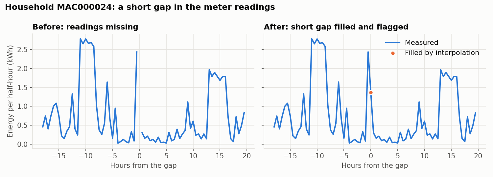
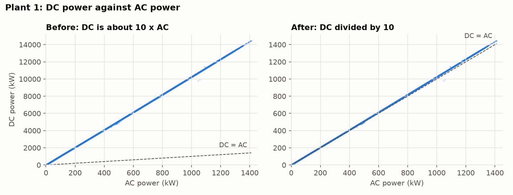
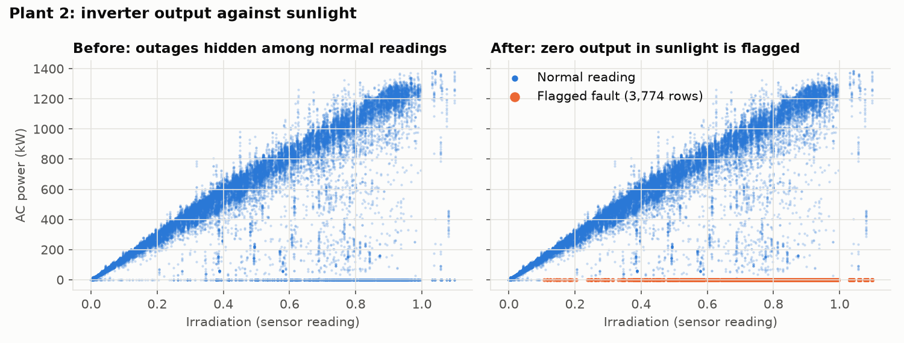

# Cleaning log

Generated by `cleaning/03_clean_data.py`. Raw files are never modified; every step runs on a copy and can be re-run.

| # | Dataset | Issue found | Action taken | Rows affected | Justification |
| --- | --- | --- | --- | --- | --- |
| 1 | London households | Socio-economic category unknown (ACORN-U or blank) | Excluded from the sampling frame | 51 households | The guiding question compares categories, so a household without one cannot be used. |
| 2 | London households | Household has under 90% of the 2013 readings | Excluded from the sampling frame | 449 households | Homes that joined or left the trial mid-year would distort seasonal and yearly totals. |
| 3 | London households | Meter reads zero most of the time (median reading is zero on over half of the days) | Excluded from the sampling frame | 22 households | Probably an empty home or a faulty meter; it does not represent a lived-in household. |
| 4 | London readings | Dataset too large for a laptop database (about 167.8 million rows) | Sampled 500 eligible households (167/167/166 per category, fixed seed) and kept 2013 only | 8,742,527 rows kept | 2013 is the only full calendar year and matches the PVGIS solar year. |
| 5 | London readings | Energy stored as text with surrounding spaces | Stripped spaces and converted to a decimal number | 8,742,527 rows | Text cannot be summed or averaged; the value itself is unchanged. |
| 6 | London readings | Non-numeric energy values (`Null`) | Treated as missing | 0 rows | A reading with no value carries no information. |
| 7 | London readings | Duplicate (household, timestamp) rows | Kept one row per household and timestamp | 0 rows | A meter produces one reading per half-hour. |
| 8 | London readings | Missing half-hours in short gaps (up to 4 in a row, i.e. 2 hours) | Filled by straight-line interpolation between the neighbouring readings; flagged `is_imputed` | 969 readings in 855 gaps | Household demand changes smoothly over two hours, so the estimate is safe, and the flag keeps it traceable. |
| 9 | London readings | Missing half-hours in long gaps (over 2 hours) or at the edges of the year | Left missing (no row written) | 16,504 readings in 194 gaps | Interpolating across many hours would invent a demand pattern that was never measured. |
| 10 | London readings | Timestamps carry no time zone and do not shift on clock-change days | Labelled as UTC (`reading_ts_utc`) | 8,743,496 rows | Each household has 48 readings on both clock-change days, so the clock never moved: the data is in GMT. |
| 11 | London readings | Solar data is hourly but meter data is half-hourly | Added an hourly file: the sum of the two half-hours, only when both are present | 4,371,602 hourly rows | Demand and solar output must share the same time step to be compared. |
| 12 | London weather | Rows are not in time order | Sorted by time | 21,165 rows | Time-series steps (gap filling, joins) need ordered rows. |
| 13 | London weather | File covers Nov 2011 to Mar 2014 | Kept 2013 only | 12,407 rows removed | Matches the year of the meter sample. |
| 14 | London weather | Hours missing from 2013 | Inserted the missing hours and interpolated their values | 2 rows added | Weather changes smoothly from hour to hour; a complete hourly grid simplifies every join. |
| 15 | London weather | Missing numeric values (mostly pressure) | Interpolated from neighbouring hours (up to 3 in a row) | 19 values | Short gaps in slowly changing measurements. |
| 16 | London weather | Columns not needed for the question (icon, wind bearing, dew point, apparent temperature, precipitation type) | Dropped | 5 columns | They do not help explain electricity demand or solar output here. |
| 17 | Inverter logs, Plant 1 | DC power is about 10 times AC power (Plant 2: about equal) | Divided DC_POWER by 10 | 68,778 rows | An inverter loses a few percent converting DC to AC, not 90%; the column is on a different scale from Plant 2. |
| 18 | Inverter logs, Plant 1 | Timestamps written as `15-05-2020 00:00` | Parsed and rewritten in one format (YYYY-MM-DD HH:MM:SS) | 68,778 rows | The two plants use different date formats; one format is needed to combine them. |
| 19 | Inverter logs, Plant 1 | Zero AC output while the sun is clearly up (irradiation above 0.1) | Kept and flagged `is_fault` | 63 rows (0.2% of sunlit rows) | These outages are real equipment behaviour and are the evidence for sub-question 4; deleting them would hide the losses. |
| 20 | Inverter logs, Plant 1 | 15-minute rows missing from the log | Left missing (no rows invented) | 3,030 rows absent of 71,808 expected | A missing log line may be a communication loss or an outage; we cannot tell which, so we do not guess. |
| 21 | Inverter logs, Plant 1 | Generation rows with no weather-sensor reading at that time | Kept with empty sensor columns; not flagged as faults | 4 rows | Without irradiation we cannot judge whether zero output is a fault. |
| 22 | Inverter logs, Plant 2 | Timestamps written as `2020-05-15 00:00:00` | Parsed and rewritten in one format (YYYY-MM-DD HH:MM:SS) | 67,698 rows | The two plants use different date formats; one format is needed to combine them. |
| 23 | Inverter logs, Plant 2 | Zero AC output while the sun is clearly up (irradiation above 0.1) | Kept and flagged `is_fault` | 3,774 rows (13.1% of sunlit rows) | These outages are real equipment behaviour and are the evidence for sub-question 4; deleting them would hide the losses. |
| 24 | Inverter logs, Plant 2 | 15-minute rows missing from the log | Left missing (no rows invented) | 4,110 rows absent of 71,808 expected | A missing log line may be a communication loss or an outage; we cannot tell which, so we do not guess. |
| 25 | PVGIS, London | Timestamps like `20130101:0010` (compact text, a few minutes past each hour) | Parsed and moved to the start of the hour (`solar_hour_utc`) | 8,760 rows | The value is the average for that hour; an on-the-hour key is needed to join with the meter data. |
| 26 | PVGIS, Beirut | Timestamps like `20130101:0009` (compact text, a few minutes past each hour) | Parsed and moved to the start of the hour (`solar_hour_utc`) | 8,760 rows | The value is the average for that hour; an on-the-hour key is needed to join with the meter data. |
| 27 | PVGIS, both cities | Output is average power in W for a 1 kWp system | Converted to energy: kWh per kWp for the hour (W / 1000) | 17,520 rows | Meter data is in kWh; one hour at P watts is P/1000 kWh. |
| 28 | PVGIS, both cities | Nested JSON (inputs, outputs.hourly, meta) with a constant `Int` column | Flattened the hourly records to a table and dropped `Int` | 17,520 rows | A flat copy is needed for the join; the original nested JSON still goes to MongoDB. |

## Before/after evidence

### 1. London readings: short gaps filled

| | Valid readings | Missing half-hours | Mean (kWh) | Median (kWh) | Max (kWh) |
| --- | --- | --- | --- | --- | --- |
| Before | 8,742,527 | 17,473 | 0.2118 | 0.121 | 5.834 |
| After | 8,743,496 | 16,504 | 0.2118 | 0.121 | 5.834 |

### 2. Plant 1: DC power rescaled

| | Mean DC power | Max DC power | Mean AC power | Max AC power |
| --- | --- | --- | --- | --- |
| Before | 3,147.4 | 14,471.1 | 307.8 | 1,411.0 |
| After | 314.7 | 1,447.1 | 307.8 | 1,411.0 |

### 3. Inverter faults flagged

| Plant | Sunlit rows | Flagged as fault | Share |
| --- | --- | --- | --- |
| Plant 1 | 30,718 | 63 | 0.2% |
| Plant 2 | 28,818 | 3,774 | 13.1% |

